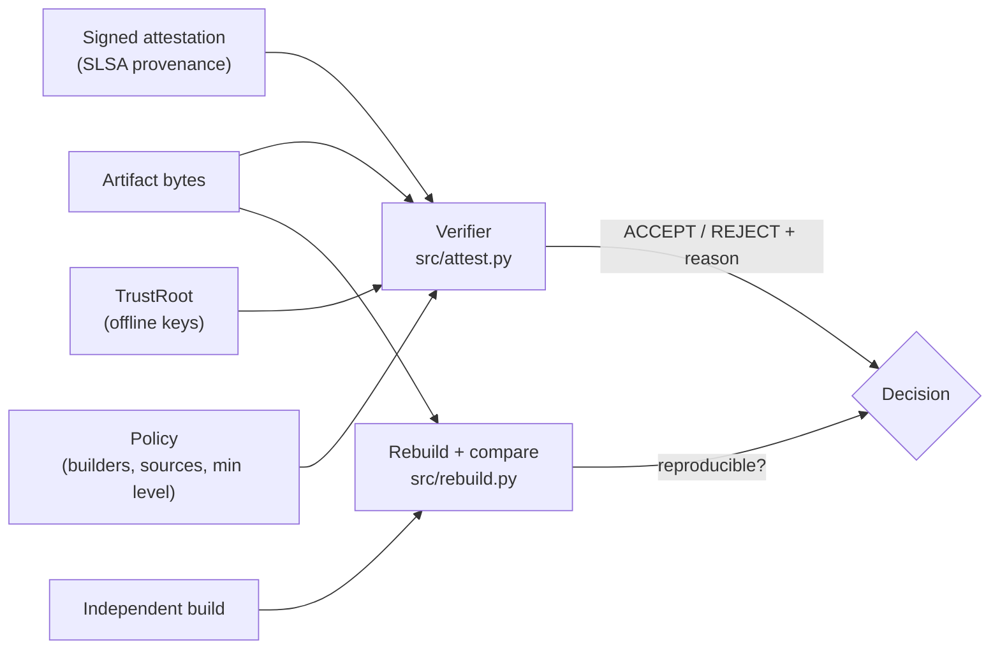

# provenance-gate

A SLSA provenance verifier that proves a binary came from the reviewed source by rebuilding it, not by trusting the attestation.

[](https://github.com/SlateGitOrg/provenance-gate/actions/workflows/ci.yml)
[Live demo](https://slategitorg.github.io/provenance-gate/)


## Why

SBOMs tell you what is in a build, not whether the build itself can be trusted. An attacker who compromises a CI runner produces a backdoored artifact with a perfectly accurate SBOM and a validly signed attestation. Signature and policy checks pass, so they cannot catch it. Only an independent rebuild can show that the artifact really came from the reviewed source.

## Features

- Verifies in-toto/SLSA-style provenance: signature against an offline trust root, artifact digest, builder identity, source repository and minimum SLSA level.
- Rejects with a specific reason code (`UNKNOWN_KEY`, `BAD_SIGNATURE`, `DIGEST_MISMATCH`, `WRONG_BUILDER`, `WRONG_SOURCE`, `SLSA_TOO_LOW`, `REPLAYED`, `NOT_REPRODUCIBLE`, `MISSING_ATTESTATION`).
- Detects replayed attestations by tracking invocation ids.
- Rebuild-and-compare with documented normalisation of timestamps, build host, source path and archive mtime, and a report of which normalisers fired.
- Canonical payload serialisation and constant-time signature comparison.
- A browser version of the decision workflow, deployed to GitHub Pages.
- Python standard library only; nothing to install.

## Architecture



`Verifier.verify` authenticates the attestation, then checks it against policy. `rebuild.compare` then checks the artifact against an independent rebuild. See [docs/ARCHITECTURE.md](docs/ARCHITECTURE.md).

## Quick start

Requires Python 3.11+. No dependencies.

```bash
git clone https://github.com/SlateGitOrg/provenance-gate
cd provenance-gate
python -m unittest discover -s tests -v   # run the test suite
python -m src.demo                        # run the tamper scenarios
```

The site needs Node 24 only for its own tests: `node --test site/core.test.mjs`.

## Usage

`python -m src.demo` output (trimmed):

```text
  genuine build                       -> ACCEPT
  binary swapped, attestation kept    -> REJECT  DIGEST_MISMATCH
  signed with a stolen-looking key    -> REJECT  BAD_SIGNATURE
  built from an attacker fork         -> REJECT  WRONG_SOURCE
  built on a developer laptop         -> REJECT  WRONG_BUILDER
  SLSA level downgraded to 1          -> REJECT  SLSA_TOO_LOW
  no attestation at all               -> REJECT  MISSING_ATTESTATION
  replay of run-1001                  -> REJECT  REPLAYED

    signature + policy verification   -> ACCEPT
    independent rebuild + diff        -> REJECT  NOT_REPRODUCIBLE
    first difference at byte 139
    normalisers applied: build timestamp, build host, absolute source path
```

The second block is a compromised runner: its attestation is correctly signed and policy-compliant, and only the rebuild exposes it.

## How it works

1. **Authenticate.** A missing attestation, unknown key id or bad HMAC-SHA256 signature is rejected first. The signed payload is canonical JSON (sorted keys, no whitespace).
2. **Bind to the artifact.** The attested subject digest must equal the SHA-256 of the artifact presented.
3. **Apply policy.** Builder id and source repository must be in the allow lists, and the SLSA level must meet the minimum.
4. **Reject replays.** A correctly signed attestation for an old build is caught by its already-seen invocation id.
5. **Rebuild and diff.** Both artifacts are normalised, then compared. Only patterns listed in `NORMALISERS` are forgiven; anything else is treated as semantic. A genuinely different build is reported as not reproducible, with the offset of the first difference.

The reference signs with HMAC-SHA256 and expresses policy as data. A production deployment would use Sigstore/x509 identities and Rego with the same decision shape.

## Testing

```bash
python -m unittest discover -s tests -v
python scripts/validate_site.py
node --test site/core.test.mjs
```

The 19 tests in `tests/test_tamper.py` cover the genuine path, each tamper class (swapped digest, forged builder, unknown key, altered source ref, unapproved builder, downgraded SLSA level, replay, missing attestation), canonical serialisation, malformed signatures, and rebuild normalisation including a case where a different build must not be reported reproducible. Each rejection is asserted by reason class, not just as a failure.

## Project layout

```text
src/attest.py     provenance model, trust root, signing, Verifier, Policy
src/rebuild.py    normalisers, compare, deterministic toy Builder
src/demo.py       tamper scenarios and compromised-builder demo
tests/            unit tests
site/             browser demo (deployed to GitHub Pages)
scripts/          site validation
docs/             architecture notes and screenshots
```

## Limitations

- Reference implementation: HMAC signing stands in for Sigstore, and policy is data rather than Rego. It is not a production verifier.
- The rebuild harness uses a deterministic toy builder, not a real toolchain.
- Replay tracking is in memory and resets on restart.
- Not an SBOM generator; it verifies provenance.

## License

MIT — see [LICENSE](LICENSE).
