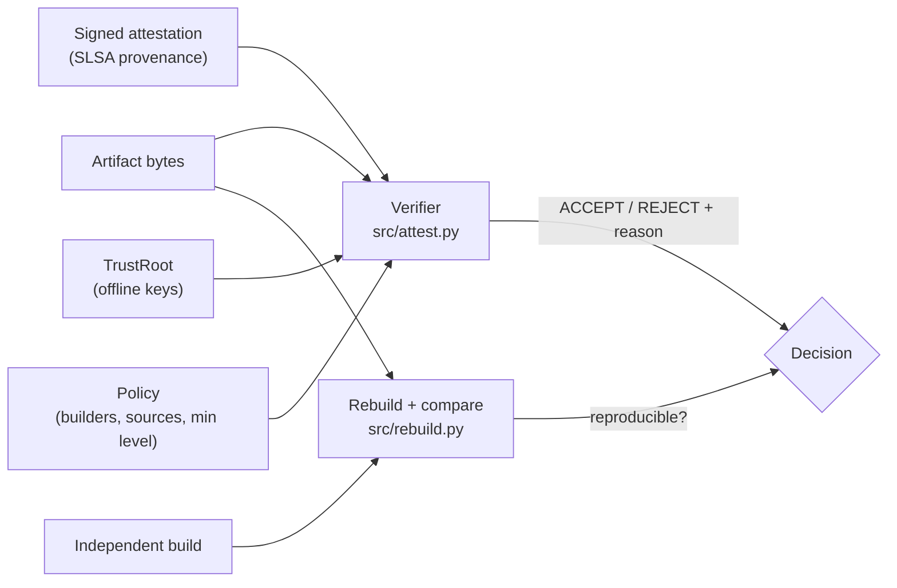

# Architecture

## Context

An SBOM says what is in a build, not whether the build itself is trustworthy: a
compromised CI runner emits a perfectly accurate SBOM for a backdoored binary.
provenance-gate answers a different question before an artifact is accepted: did
this binary come from the reviewed source, on a permitted builder, and does an
independent rebuild produce the same bytes?

## Components

- `src/attest.py` models the provenance (subject, build definition, run details),
  canonically serialises it, signs and verifies it with an offline trust root,
  and runs the ordered checks of `Verifier.verify`.
- `src/rebuild.py` normalises incidental nondeterminism, compares an original
  artifact with an independent rebuild and reports what it forgave.
- `src/demo.py` runs eight tamper attempts and the compromised-builder case.
- `site/` is a browser version of the decision workflow, deployed to GitHub Pages.

## Key decisions

- **Rebuild, don't trust.** Signature and policy checks prove an attestation is
  authentic and compliant, not that it is true. Only an independent rebuild can
  expose a compromised builder that signs whatever it likes. The cost is a second
  build per release.
- **Fixed check order with named reasons.** Missing attestation, unknown key, bad
  signature, digest mismatch, builder, source, SLSA level, replay. Every rejection
  carries a specific reason code from `REASONS`, so a failure is actionable.
- **Canonical payload.** Keys are sorted and whitespace removed before signing, so
  a re-serialised attestation verifies and nobody is tempted to disable the check.
- **Offline trust root.** Verification needs no network, so it works in air-gapped
  release pipelines. The reference uses HMAC-SHA256 from the standard library.
- **Strict normalisation.** Only listed patterns (timestamp, host, source path,
  archive mtime) are forgiven. Anything else is semantic and causes a mismatch;
  an over-eager normaliser would pass genuinely different binaries.
- **Constant-time signature comparison** via `hmac.compare_digest`.

## Failure modes

- Unsigned, wrongly signed or unknown-key attestations are rejected, never
  treated as "probably fine".
- A replayed, correctly signed attestation is caught by the invocation-id check.
- A non-reproducible build is reported as such, with the offset of the first
  differing byte, rather than passed.
- Replay tracking is in memory, so it resets when the process restarts.

## Out of scope

- Generating SBOMs.
- Real Sigstore, x509 identities or Rego policy; the reference uses HMAC signing
  and policy as data with the same decision shape.
- Building real software: the rebuild harness uses a deterministic toy builder.
